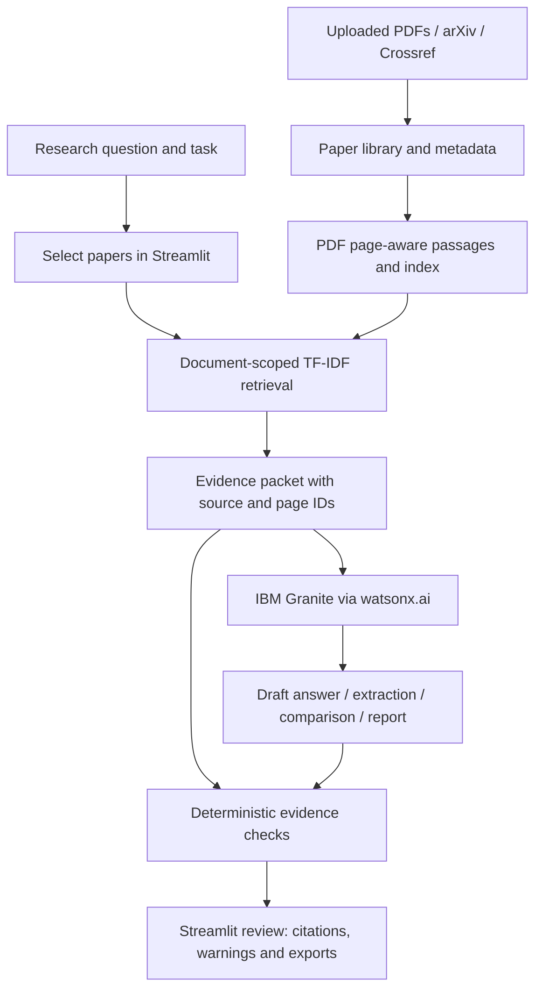

<div align="center">

# ResearchLens AI

### Evidence-Grounded Research Agent with IBM Granite

**Discover papers · Ask research questions · Compare studies · Generate reviewable drafts**

[](https://www.python.org/)
[](https://streamlit.io/)
[](https://www.ibm.com/granite)


**[Live Streamlit App](https://research-agent-w5sphgb24eusjwdykiwlrc.streamlit.app)** &nbsp;·&nbsp; **[GitHub Repository](https://github.com/SayanGhorai/research-agent)** &nbsp;·&nbsp; **[Presentation](ResearchLens_AI_Sayan_Ghorai_Project_Presentation.pptx)** &nbsp;·&nbsp; **[Problem Statement](yourproblemstatement.pdf)**

</div>

---

ResearchLens AI is a research-assistance application developed by **Sayan Ghorai, VIT Bhopal University**, for the **IBM SkillsBuild / AICTE internship through Edunet Foundation**. It helps students and researchers work with scholarly papers using document-aware retrieval and the **IBM Granite 4 H Small** model through **IBM watsonx.ai**.

Instead of returning only an AI-generated answer, the application keeps the selected papers, retrieved evidence, PDF page references, and validation warnings visible. ResearchLens AI is designed to **assist research and drafting—not replace human evaluation of the literature**.

> **Project status — 05 November 2026:** The application has been developed, locally tested, and published to GitHub. The hosted Streamlit interface is available. Live Granite generation was demonstrated **locally**; successful hosted generation was **not independently confirmed**. Scientific answer quality remains partially validated.

## At a Glance

| Project | Details |
|:--|:--|
| **Problem statement** | No. 1 — Research Agent |
| **Domain** | Education · Academic and scientific research |
| **Application** | Python 3.12 + Streamlit |
| **Generative AI** | `ibm/granite-4-h-small` through watsonx.ai |
| **Demonstrated retrieval** | TF-IDF with selected-document filtering |
| **Research sources** | Uploaded PDFs · arXiv · Crossref |
| **Agent roles** | Search · Read / Extract · Write · Verify |
| **Local verification** | **224** regression tests passed + **24** separate offline UI checks |
| **Release** | GitHub `main` · Streamlit Community Cloud |

## Overview

Finding articles is only one part of academic research. Researchers must also read papers, identify methods and findings, compare studies with different datasets, organize citations, and prepare drafts. A typical chatbot may produce a convincing response while mixing details from different papers or overlooking important source information.

ResearchLens AI addresses this with a **source-first workflow**. Users add PDFs or discover literature, select the papers that are relevant, and choose a research task. The application retrieves passages from those sources before requesting a bounded response from Granite. Its interface then displays the result alongside review information so the user can return to the original material.

The system is **domain-independent**. Plant-leaf-disease research papers were used to demonstrate the workflow; the application itself is not a plant-disease detection model.

## Key Features

| Feature | What it does |
|:--|:--|
| **Literature discovery** | Search arXiv and Crossref, review scholarly metadata, and reduce duplicate entries. |
| **PDF research library** | Upload papers, index page-aware text passages, select sources, and edit bibliographic information. |
| **Research Q&A** | Ask natural-language questions using evidence retrieved from the selected papers. |
| **Paper summarization** | Generate structured research summaries with citations and review warnings. |
| **Structured extraction** | Extract objective, method, dataset, findings, metrics, and limitations; keep uncertain values marked for review. |
| **Multi-paper comparison** | Compare selected papers side by side, with tentative differences and evidence references. |
| **Research writing** | Produce research briefs, proposed hypotheses, and draft paper sections for human editing. |
| **References and exports** | Export bibliographic data, draft outputs, evidence records, and review worksheets. |

**How to interpret these features:** They are implemented application routes, **not** a claim that every generated answer is scientifically accurate. Five core features were reviewed using live results; hypothesis generation and section drafting also had mocked integration checks, but their live output quality was not fully evaluated.

## Application Interface

The Streamlit interface is organized into five tabs.

| Tab | Main purpose |
|:--|:--|
| **Research Workspace** | Enter a research question, choose a task, and select source papers. |
| **Paper Library** | Search or upload papers, inspect entries, and update metadata. |
| **Compare & Extract** | Compare research papers and review structured extraction fields. |
| **Reports & References** | Prepare, inspect, and export research drafts and bibliography files. |
| **About & Diagnostics** | View the active configuration, generation limits, and usage information. |

### Application Screenshots — To Be Added

The next README update will include verified captures from the finished application. The planned gallery will cover the **research workspace**, **uploaded paper library**, **source-grounded answer**, **paper comparison**, **structured extraction**, and **report/reference exports**.

**Screenshots have intentionally not been embedded yet.** There are no broken image paths or placeholder images in this version; final screenshots will be placed under `assets/screenshots/` after they are selected.

## System Architecture



The demonstrated workflow uses **local TF-IDF retrieval** to select source passages and **hosted Granite** only when a user requests generation. Source selection and citation identifiers are retained through the workflow. In preview mode, users can inspect available evidence without a Granite call.

### Four Bounded Agent Roles

| Agent | Responsibility |
|:--|:--|
| **Search** | Discover papers and assemble scholarly records. |
| **Read / Extract** | Retrieve relevant, document-scoped passages and support structured research tasks. |
| **Write** | Ask IBM Granite to synthesize a draft from a limited evidence packet. |
| **Verify** | Check citation IDs, numerical consistency, source scope, and incomplete fields. |

The agents are Python components—not four independently running language models. Verification checks are **rules-based**: they can detect some unsupported references and numerical inconsistencies but cannot guarantee factual or scientific correctness.

### Retrieval and Generation

- **Active in the final demonstration:** TF-IDF passage retrieval with strict selected-paper scope.
- **Optional, not active in that demonstration:** Sentence-Transformer MiniLM and reciprocal-rank fusion. Semantic search is disabled with `ENABLE_SEMANTIC_SEARCH=false` and is not required for the working demo.
- **Generation model:** `ibm/granite-4-h-small`, accessed through the IBM watsonx.ai SDK.
- **Interaction model:** User-triggered, bounded generation; no automatic open-ended answer-repair loop.

## Evidence, Validation and Exports

ResearchLens AI aims to make the distinction between **a generated draft** and **a reviewed finding** visible.

| Output / control | Why it matters |
|:--|:--|
| **Selected-paper scope** | Prevents unrelated library entries from being deliberately used as evidence. |
| **PDF page references** | Helps users locate the cited source material. |
| **Evidence ledger** | Records source-linked claims and their validation states. |
| **Run trace** | Records workflow information, warnings, and available model-use details. |
| **Draft vs. checked extraction** | Retains uncertain field values for review instead of silently accepting them. |
| **Export formats** | Provides Markdown, JSON, CSV, and BibTeX outputs where applicable. |

Validation labels such as `valid`, `partial`, `invalid`, and `unchecked` describe **software checks**, not independent confirmation that a scientific claim is true. Some claims, citations, and bibliography details from the live evaluation still require correction by the reader.

## Technology Stack

| Layer | Technologies |
|:--|:--|
| **Frontend** | Streamlit |
| **Programming language** | Python 3.12 |
| **IBM AI** | IBM Granite · watsonx.ai · `ibm-watsonx-ai` SDK |
| **PDF processing** | `pypdf`, with font-related support as needed |
| **Retrieval** | scikit-learn TF-IDF · NumPy |
| **Optional semantic retrieval** | MiniLM Sentence Transformers (disabled in the recorded demo) |
| **Source discovery** | arXiv Atom feed · Crossref REST API |
| **Data models and exports** | Pydantic · Markdown · CSV · JSON · BibTeX |
| **Development and testing** | VS Code · pytest · GitHub Actions · IBM Bob assistance |
| **Deployment** | GitHub · Streamlit Community Cloud |

IBM Bob was used as a **development and troubleshooting assistant**. The research application's runtime language model is IBM Granite.

## Repository Structure

```text
research-agent/
├── app.py                         # Streamlit application entry point
├── researchlens/
│   ├── agents.py                  # Search, Read, Write and Verify logic
│   ├── config.py                  # Configuration and safety settings
│   ├── ingestion.py               # Uploaded PDF processing
│   ├── retrieval.py               # Document index and search
│   ├── sources.py                 # arXiv and Crossref integration
│   ├── watsonx_client.py          # IBM Granite connection
│   ├── workflow.py                # Task coordination
│   ├── schemas.py                 # Typed records
│   ├── exports.py                 # Report and reference outputs
│   └── ui.py                      # UI support utilities
├── tests/                         # Automated regression tests
├── eval/                          # Offline evaluation script and records
├── .github/workflows/ci.yml       # GitHub Actions checks
├── .env.example                   # Example private configuration
├── requirements.txt               # Runtime dependencies
├── requirements-dev.txt           # Testing dependencies
├── PROJECT_STATUS.md              # Earlier development-phase log
├── THIRD_PARTY_NOTICES.md         # Dependency acknowledgements
├── app.json                       # Project metadata manifest
├── yourproblemstatement.pdf       # Internship problem statement
├── ResearchLens_AI_Sayan_Ghorai_Project_Presentation.pptx
└── README.md
```

This shows the main project files, not every development or local-only artifact. The optional screenshot directory will be added when final images are ready.

> `app.py` is the executable application. `app.json` is a **descriptive project manifest**, not a runnable application or visual-workflow export.

## Local Setup

The following commands are for **Windows PowerShell**. Python **3.12** is recommended.

**1. Clone the repository**

```powershell
git clone https://github.com/SayanGhorai/research-agent.git
cd research-agent
```

**2. Create the environment and install dependencies**

```powershell
py -3.12 -m venv .venv
.\.venv\Scripts\python.exe -m pip install -r requirements.txt
```

**3. Create a private configuration file**

```powershell
Copy-Item .env.example .env
```

Edit `.env` using the documented settings below. Leave generation disabled for preview mode or until your watsonx.ai credentials have been configured and tested.

**4. Launch Streamlit**

```powershell
.\.venv\Scripts\python.exe -m streamlit run app.py --server.address 127.0.0.1
```

Open the local address shown in the terminal, normally `http://127.0.0.1:8501`. Press **Ctrl + C** to stop the server.

### Essential Configuration

| Environment variable | Purpose |
|:--|:--|
| `WATSONX_API_KEY` | IBM Cloud API key; keep private. |
| `WATSONX_PROJECT_ID` | watsonx.ai project ID. |
| `WATSONX_URL` | IBM regional inference endpoint. |
| `WATSONX_MODEL_ID` | Model identifier; local demo used `ibm/granite-4-h-small`. |
| `ALLOW_LIVE_GENERATION` | Enables or disables Granite generation. |
| `ENABLE_SEMANTIC_SEARCH` | Set `false` for the demonstrated TF-IDF-only configuration. |
| `APP_ACCESS_PASSWORD` | Application access guard used for protected deployment. |
| `MAX_LLM_CALLS_PER_ACTION` | Request budget per user action. |
| `MAX_OUTPUT_TOKENS` | Limit on generation output length, not total request tokens. |
| `APP_ENV` | `local`, `staging`, or `production`. |

See [`.env.example`](.env.example) for the full configuration template. Use the exact **`WATSONX_`** names—not `IBM_WATSONX_`. No IBM API key, password, or populated `.env` belongs in the public repository.

## How to Use

1. **Add papers:** Upload PDF files or discover research using arXiv/Crossref.
2. **Choose sources:** Select the papers relevant to the question or comparison.
3. **Choose a task:** Ask a question, summarize, compare, extract, generate a report, propose a hypothesis, or draft a section.
4. **Run the task:** Inspect the evidence and, where enabled, request a Granite-generated draft.
5. **Review and export:** Check source pages, warnings, citations, and bibliography details before downloading.

The demonstrated upload constraints are **up to 3 PDFs per session, 10 MB per PDF, and 40 pages per PDF**. Source discovery requires network access; local PDF parsing and TF-IDF lookup do not require an IBM model request.

## Testing and Demonstration Results

| Check | Recorded result | Interpretation |
|:--|:--|:--|
| Regression tests | **224 passed** | Functional/software checks in the owner's local environment. |
| Additional UI helper checks | **24 passed** | Separate offline checks for warnings, extraction review states, and controls. |
| Live IBM Granite generation | **Successful locally** | Confirms model integration in the local demonstration. |
| Core research task review | **5 task types reviewed live** | Outputs contained useful drafts and documented quality limitations. |
| Hypothesis and section-draft routes | **Mocked integration checks** | Implemented, but live output quality review remains incomplete. |
| Public Streamlit interface | **Deployed** | Hosted interface availability was observed; cloud generation unconfirmed. |

The five live-reviewed task types were **question answering, paper comparison, structured extraction, paper summarization, and report generation**. The application is a student research prototype, not a scientific-answer benchmark.

### Example: Source-Linked Summary

In the recorded local demonstration, a research PDF produced **49 indexed passages**, and the interface showed **1 of 5** session model calls used. The generated summary was displayed with evidence and a partial-validation status. It demonstrated a working end-to-end interaction **without proving that every scientific statement in the draft was correct**.

### Observed IBM Token Usage

| IBM project dashboard | Tokens |
|:--|--:|
| Before the local demonstration | 46,074 |
| After the local demonstration | 48,550 |
| **Observed increase** | **2,476** |

These are **cumulative dashboard readings**, not available tokens or a separately verified per-request bill. The interval difference can be affected by reporting delay or other project activity. The original screenshots are included in the [project presentation](ResearchLens_AI_Sayan_Ghorai_Project_Presentation.pptx).

### Run the Tests

```powershell
.\.venv\Scripts\python.exe -m pip install -r requirements-dev.txt
.\.venv\Scripts\python.exe -m pytest -q
```

The older phase log and saved evaluation files reflect earlier checkpoints. Their historical **182-test** and synthetic retrieval metrics should not be confused with the latest recorded **224-test** local suite. See [`PROJECT_STATUS.md`](PROJECT_STATUS.md) and [`eval/`](eval/) for development history and evaluation materials.

## Deployment and Safety

The application is deployed on **Streamlit Community Cloud**, using `app.py` from the `main` branch. Hosted secrets must be configured separately from the local `.env` file. A working hosted interface does **not** automatically establish that cloud IBM Granite generation is configured correctly.

- **Generation is opt-in:** Live inference must be enabled explicitly with valid private credentials.
- **Browser-session call guard:** The current interface records up to **5 model calls per browser session**. This is **not** an account-wide token, spending, or security limit.
- **Session data:** The application uses an in-memory session library; export important work before closing or restarting.
- **Private files:** Never commit `.env`, `secrets.toml`, passwords, private uploaded papers, or local backup folders.
- **Source integrity:** Uploaded papers are reference material, not trusted instructions for the assistant.

If exposing live generation publicly, add provider-side usage controls. An application password and a browser-session counter are not substitutes for global abuse protection.

## Known Limitations

| Area | Current limitation |
|:--|:--|
| **Citation accuracy** | A generated claim can cite a related passage without that passage fully supporting the statement. |
| **Scientific completeness** | Important findings can be missed, particularly when the evidence packet contains only a few retrieved passages. |
| **Cross-paper synthesis** | Results from a paper's related-work section may be confused with that paper's own experiments. |
| **PDF understanding** | Scans, complex tables, and inaccessible figures may not be fully captured by text extraction. |
| **Structured extraction** | Generated fields may remain draft-only or need manual checking. |
| **References** | Author/year/DOI metadata may be incomplete or require correction. |
| **Validation** | A `valid` software check cannot certify scientific truth. |
| **Hosting and budgets** | Hosted generation and account-wide spending protections were not fully validated in the recorded release. |

Research-gap claims, comparisons, hypotheses, and draft paper sections should be treated as **starting points for human research**, not verified findings. The project deliberately displays review warnings instead of claiming that all outputs are error-free.

## Future Improvements

- Better per-claim citation alignment and distinction between a study's findings and cited work.
- Improved extraction of tables, scanned pages, and publication metadata.
- Broader quality evaluation using research papers from different domains.
- Optional semantic retrieval testing on more representative questions.
- Persistent usage controls and further hosted Granite verification.
- A polished, documented screenshot gallery from the final application.

These are **future development ideas**, not features claimed as completed in this version.

## Author and Acknowledgements

**Sayan Ghorai** · VIT Bhopal University
IBM SkillsBuild / AICTE Internship — Edunet Foundation

Built with Python, Streamlit, IBM watsonx.ai and IBM Granite. **IBM Bob** supported development and troubleshooting; the final application was independently reviewed through local tests and demonstrations.

This repository includes educational project material. Its public visibility does not by itself grant an open-source license; a project license has not been selected. See [`THIRD_PARTY_NOTICES.md`](THIRD_PARTY_NOTICES.md) for external component acknowledgements. Research papers and their scientific results belong to their original authors.

---

<div align="center">

**ResearchLens AI — From research papers to evidence-linked drafts.**
[Open the Application](https://research-agent-w5sphgb24eusjwdykiwlrc.streamlit.app) · [View Source Code](https://github.com/SayanGhorai/research-agent)

</div>
